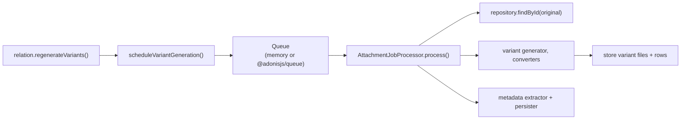

# Background processing

Generating variants can be slow, so the package runs it as a **job** off the request path.
`AttachmentService.scheduleVariantGeneration` emits a serializable `generate-variants` job;
a worker later resolves the original and runs your converters.

You choose how that job runs. Start with the in-memory queue and graduate to a real worker
when you need to.

## The common adapter form

Queue configuration follows the same pattern as storage and store:

```ts
import { defineConfig, LocalFileStorage, MemoryAttachmentQueue } from '@jrmc/adonis-attachment'
import { LucidAttachmentStore } from '@jrmc/adonis-attachment/lucid'

export default defineConfig({
  storage: LocalFileStorage.fromApp,
  store: LucidAttachmentStore.fromApp,
  queue: MemoryAttachmentQueue.configure({ concurrency: 2 }),
})
```

Use `MemoryAttachmentQueue.fromApp` for defaults, or omit `queue`. Both use the configured
store's processor. `AdonisAttachmentQueue.configure({ job, queueName })` returns an external
queue factory. Adapter instances and custom `(app, context) => queue` factories are also accepted.
See [the shared adapter contract](/guide/configuration#a-common-adapter-pattern).

### A custom queue

A custom adapter only needs `enqueue(job): Promise<void>`. For example, a factory can obtain
a queue supplied by your application's BullMQ integration:

```ts
queue: async (app, context) => {
  const queue = await app.container.make('app.attachmentQueue')
  // This application binding implements AttachmentQueue and dispatches serializable jobs.
  return queue
},
```

The binding name above is application-defined; the package does not install BullMQ or start
its workers. A worker uses `createAttachmentProcessor(app)` as shown below. For an in-process
custom queue, `context.handler` is available when a store or `jobHandler` is configured.
Invoke it when a job runs, after configuration resolves. A direct queue instance owns its
handler wiring. Do not resolve `jrmc.attachment` inside the factory.

## Named connections

Declare several queue connections and select the one used by all attachment jobs:

```ts
import { defineConfig, LocalFileStorage, MemoryAttachmentQueue, AdonisAttachmentQueue } from '@jrmc/adonis-attachment'
import GenerateAttachmentVariants from '#jobs/generate_attachment_variants'

export default defineConfig({
  storage: LocalFileStorage.fromApp,
  queue: {
    default: 'memory',
    connections: {
      memory: MemoryAttachmentQueue.configure({ concurrency: 1 }),
      background: AdonisAttachmentQueue.configure({
        job: GenerateAttachmentVariants,
        queueName: 'attachments',
      }),
    },
  },
})
```

`default` is typed from the declared connection keys. An unknown or missing default fails
configuration resolution at application boot with `E_INVALID_ATTACHMENT_CONFIG`; it does
not silently fall back to memory. Omitting `queue` entirely still selects the built-in memory queue.

Only the selected connection is initialized. A connection can be a driver configuration,
a queue instance, or a factory receiving `(app, context)`. For the memory driver,
the selected store supplies automatic memory processing, and `jobHandler` remains an advanced override.
Factories receive the optional processor as `context.handler`; direct instances own their handler wiring.

The selected connection handles both variant and metadata jobs. `background` is a connection
name within this package; `queueName: 'attachments'` is the destination within Adonis Queue.
This does not add per-attachment routing or change the native job's queue-name precedence.

The existing short form (`queue: { driver: 'memory', concurrency: 2 }`), direct instances,
and application factories remain supported.

### Select by environment

Add an optional enum to your existing `start/env.ts` schema (keep the application's other
variables). This preserves the connection-name union instead of accepting an arbitrary string:

```ts
// Inside the schema passed to Env.create(...), using its existing Env import:
ATTACHMENT_QUEUE: Env.schema.enum.optional(['memory', 'background'] as const),
```

Import `env` from `#start/env` in `config/attachment.ts` and use:

```ts
queue: {
  default: env.get('ATTACHMENT_QUEUE', 'memory'),
  connections: {
    memory: MemoryAttachmentQueue.configure({ concurrency: 1 }),
    background: AdonisAttachmentQueue.configure({
      job: GenerateAttachmentVariants,
      queueName: 'attachments',
    }),
  },
},
```

Set `ATTACHMENT_QUEUE=memory` locally and `ATTACHMENT_QUEUE=background` in the environment
where you run the external worker. If omitted, the example selects memory. Restart the
application after changing the variable: connection selection is fixed when configuration
is resolved, not reevaluated for each upload. Keep the application's and worker's configuration
consistent. The generated config uses `MemoryAttachmentQueue.fromApp` and needs no env
schema change until you add this environment-based selection.

### Lazy optional connections

Selecting memory prevents initialization of the external adapter, but ordinary top-level
imports still execute when the config module loads. To avoid importing an unused job class
and its optional dependencies, declare that connection as a factory instead:

```ts
import { AdonisAttachmentQueue } from '@jrmc/adonis-attachment'

// Inside queue.connections:
background: async () => {
  const { default: GenerateAttachmentVariants } = await import('#jobs/generate_attachment_variants')
  return new AdonisAttachmentQueue({
    job: GenerateAttachmentVariants,
    queueName: 'attachments',
  })
},
```

The factory is called only if `default` selects `background`. You may also use its `app`
argument to resolve application services. Preconstructed queue instances have already been
initialized by your code, so use a factory when initialization itself must be deferred.

## In-memory queue (default)

Pending jobs are not durable: a process restart loses them, and failed jobs are not
automatically retried. Use a persistent queue when those guarantees matter.

If you configure nothing, `MemoryAttachmentQueue` runs jobs **in the same process** - great
for development, tests, and simple deployments. When `store` is configured, the package
creates a processor using that store's repository, variant persistence and metadata
persister. No Lucid detection is performed.

The default concurrency is `1`; use `configure()` only when you need to change it or
install a failure handler:

```ts
import { defineConfig, LocalFileStorage, MemoryAttachmentQueue } from '@jrmc/adonis-attachment'

export default defineConfig({
  storage: LocalFileStorage.fromApp,
  queue: MemoryAttachmentQueue.configure({
    concurrency: 2,
    onFailure(job, error) {
      console.error(`Attachment job ${job.type} failed`, error)
    },
  }),
})
```

`onFailure` is called when the processor throws. It can be synchronous or asynchronous and
receives both the failed job and the original error. Without this callback, the in-memory queue
finishes the failed job silently, so production applications should report failures explicitly.

Outside Lucid, the package cannot infer how originals and generated variants are persisted.
Configure a store or a custom `jobHandler` before scheduling memory jobs; otherwise
`enqueue` rejects with `E_ATTACHMENT_PROCESSOR_NOT_CONFIGURED`. A `jobHandler` overrides
the store's memory processor. Read-only stores reject unsupported variant/metadata jobs
explicitly instead of routing them to Lucid.

### Creating the processor for a worker

An external worker does not use the memory queue's automatic processor. Create its processor
once in an application module with the store-aware factory:

```ts
// app/attachments/processor.ts
import app from '@adonisjs/core/services/app'
import { createAttachmentProcessor } from '@jrmc/adonis-attachment'

export default createAttachmentProcessor(app)
```

The factory resolves the configured store, attachment service and converters lazily.
It works with the Lucid store (including legacy JSON) or a custom store. To replace
lifecycle events, pass `{ events }` as the second argument.
See [Events](/guide/events#workers-and-external-queues).

For a custom data store, see the complete
[variant persistence wrapper and processor](/guide/custom-persistence#generating-and-persisting-variants).

## A real worker with `@adonisjs/queue`

For production, dispatch jobs to `@adonisjs/queue`. `AdonisAttachmentQueue` adapts your job
class to the package's queue interface:

Install and configure the integration with `node ace add @adonisjs/queue`, then generate
the forwarding job with `node ace make:job generate_attachment_variants`. Complete the
queue driver's own connection and persistence setup before dispatching jobs.

```ts
import { defineConfig, LocalFileStorage, AdonisAttachmentQueue } from '@jrmc/adonis-attachment'
import GenerateAttachmentVariants from '#jobs/generate_attachment_variants'

export default defineConfig({
  storage: LocalFileStorage.fromApp,
  queue: AdonisAttachmentQueue.configure({
    job: GenerateAttachmentVariants,
    queueName: 'attachments',
  }),
})
```

Worker concurrency belongs to `@adonisjs/queue` and stays in its own worker configuration;
`queueName` is the default destination for Attachment jobs. A queue declared by the job takes
precedence, so the resolution order is:

1. `Job.options.queue`
2. Attachment's `queueName`
3. the native `default` queue from `@adonisjs/queue`

Omit `queueName` when every job should rely entirely on its own Adonis Queue configuration.

Your job owns dependency injection and simply forwards its payload to the processor:

```ts
import { Job } from '@adonisjs/queue'
import type { AttachmentJob } from '@jrmc/adonis-attachment'
import attachmentProcessor from '#attachments/processor'

export default class GenerateAttachmentVariants extends Job<AttachmentJob> {
  async execute() {
    await attachmentProcessor.process(this.payload)
  }
}
```

This keeps the package independent of how and where your workers are deployed. Variant jobs
contain an id and optional keys; metadata jobs also contain the serializable attachment target
but never its file bytes. The worker reads the stored file before extracting metadata.

Start a worker in another terminal, listening to the same queue as the configuration:

```sh
node ace queue:work --queue=attachments
```

Upload an original with `variants: ['thumbnail']`, then read the relation's `variants()`
after processing. A missing worker leaves jobs pending. The worker needs the same database,
storage access, configuration, optional media packages, and binary executables as the application.

## Instantiating the built-in queues directly

Both adapters can also be instantiated directly. This is useful when you build the handler yourself or reuse the queue outside the
standard configuration factory:

```ts
import { MemoryAttachmentQueue, defineConfig, LocalFileStorage } from '@jrmc/adonis-attachment'
import attachmentProcessor from '#attachments/processor'

export default defineConfig({
  storage: LocalFileStorage.fromApp,
  queue: new MemoryAttachmentQueue({
    handler: (job) => attachmentProcessor.process(job),
    concurrency: 2,
  }),
})
```

```ts
import { AdonisAttachmentQueue, defineConfig, LocalFileStorage } from '@jrmc/adonis-attachment'
import GenerateAttachmentVariants from '#jobs/generate_attachment_variants'

export default defineConfig({
  storage: LocalFileStorage.fromApp,
  queue: new AdonisAttachmentQueue({
    job: GenerateAttachmentVariants,
    queueName: 'attachments',
  }),
})
```

With direct instantiation, you are responsible for wiring the memory queue's `handler`. The
Adonis adapter still only dispatches jobs; the job worker must invoke the processor as shown
above.

## Waiting for the memory queue in tests

When constructing a memory queue in a Japa test, retain the instance and await `drain()`
instead of waiting a fixed number of milliseconds:

```ts
import { test } from '@japa/runner'
import { MemoryAttachmentQueue } from '@jrmc/adonis-attachment'

test('processes an attachment job', async ({ assert }) => {
  const processed: string[] = []
  const failures: unknown[] = []
  const queue = new MemoryAttachmentQueue({
    handler: async (job) => {
      if (job.type === 'generate-variants') processed.push(job.attachmentId)
    },
    onFailure: (_job, error) => { failures.push(error) },
  })

  await queue.enqueue({ type: 'generate-variants', attachmentId: 'original-id' })
  await queue.drain()
  assert.deepEqual(processed, ['original-id'])
  assert.isEmpty(failures)
})
```

This tests queue execution only. To test actual conversion, use your processor as the
handler and assert the persisted variants after draining. `drain()` waits for completion
but does not rethrow job failures, so always capture and assert `onFailure` in such tests.

## Another queue library

The named drivers are conveniences for the built-in integrations. Any instance or application
factory implementing `AttachmentQueue` remains valid, so BullMQ, RabbitMQ, SQS, or another
transport does not require a new core driver:

```ts
export default defineConfig({
  storage: LocalFileStorage.fromApp,
  queue: (app) => new BullMqAttachmentQueue({
    connection: app.config.get('redis'),
  }),
})
```

```ts
interface AttachmentQueue {
  enqueue(job: AttachmentJob): Promise<void>
}
```

## The flow at a glance



**Next:** [Storing with Lucid](/guide/lucid).
